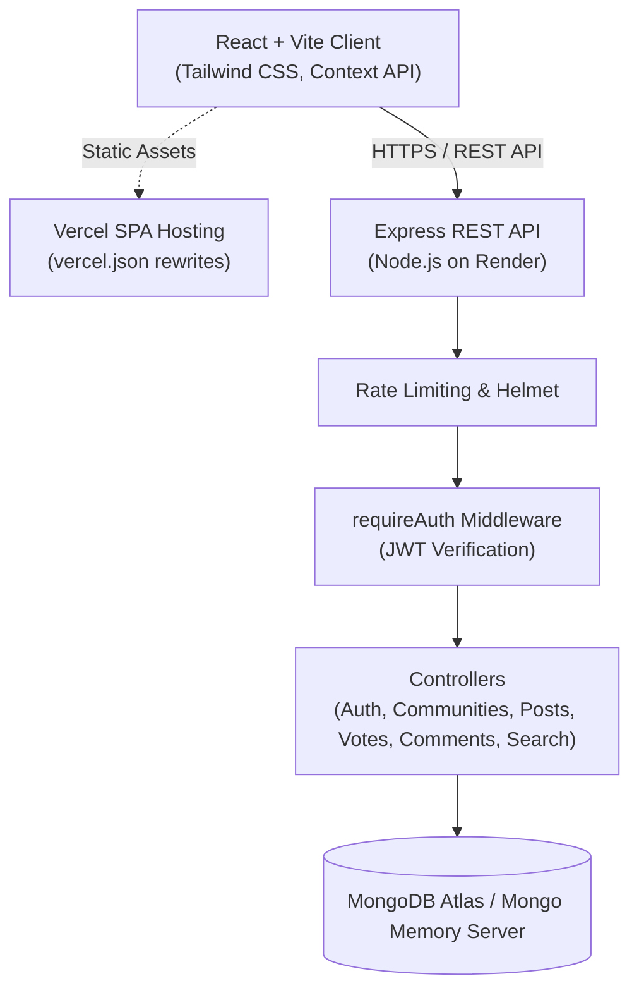
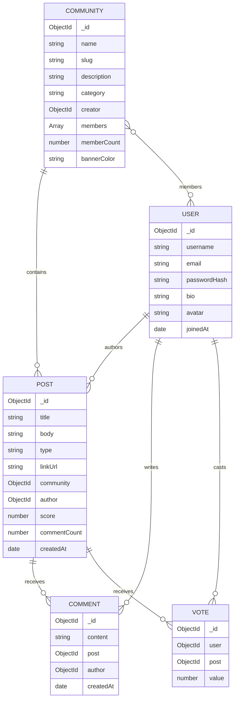

# CircleUp — Interest-Based Community Discussion Platform

CircleUp is an editorial-style, interest-based community platform inspired by Reddit's discussion model. Built for modern web experiences, CircleUp enables users to discover and subscribe to interest circles, initiate discussions, share external articles, upvote and downvote content, participate in threaded conversations, and curate discussions.

Designed and engineered as a full-stack undergraduate capstone submission, the platform features a custom brand identity (warm off-white surfaces, crisp typography, and restrained indigo/violet accents), atomic database operations, strict ownership authorization, and reliable end-to-end workflows.

---

## 1. Problem Statement & Proposed Solution

### The Problem
Mainstream social discussion networks have become overly cluttered with algorithmic ad bloat, dark patterns, and noisy interfaces. Additionally, building robust community discussion systems involves non-trivial engineering hurdles:
1. Concurrency anomalies when calculating community member counts and post scores.
2. Duplicate vote injection when users click repeatedly.
3. Inconsistent client-side state when refreshing nested dynamic routes (`/c/:communityName`, `/post/:postId`).
4. Flawed authorization where modifying an ID in an API payload allows altering another user's content.

### The CircleUp Solution
CircleUp implements:
- **Calm, Editorial UX**: A 3-column desktop layout with high-readability typography, subtle shadows, and responsive mobile drawers.
- **Atomic MongoDB Counter Tracking**: `$inc` and `$addToSet` operations combined with compound unique indexes to guarantee database invariants without race conditions.
- **State Machine Voting**: Server-side transitions for Upvote (+1), Downvote (-1), Vote Toggle (+2 / -2), and Vote Revocation (0) with duplicate prevention.
- **Documented Gravity-Based Trending Algorithm**: Dynamically balances community engagement and recency.
- **Strict Server-Side Ownership Controls**: Every update and delete operation verifies cryptographic ownership before mutation.

---

## 2. Target Users

- **Developers & Engineers**: Sharing technical articles, architectural patterns, and debugging stories in `c/webdev` and `c/technology`.
- **Designers**: Discussing typography, micro-interactions, and design tokens in `c/design`.
- **Gamers & Creators**: Showcasing procedural generation and indie mechanics in `c/gaming`.
- **Students & General Hobbyists**: Asking questions, sharing advice, and debating ideas in `c/askcircle`.

---

## 3. Technology Stack

| Layer | Technology | Rationale |
|---|---|---|
| **Frontend Framework** | React 18 + Vite | Rapid Hot Module Replacement, standard JavaScript (ES Modules, no TSX/TypeScript). |
| **Styling** | Tailwind CSS v3 | Custom editorial palette (`#F8F9FA` background, `#4F46E5` indigo accents, subtle borders). |
| **Routing** | React Router v6 | Dynamic routing (`/c/:communityName`, `/post/:postId`, `/profile/:username`), protected routes. |
| **State Management** | Context API | Global authentication session (`AuthContext`) and toast notifications (`ToastContext`). |
| **API Client** | Axios | Interceptors for Bearer token injection and automatic 401 session expiry handling. |
| **Icons** | Lucide React | Modern, clean vector iconography. |
| **Backend Runtime** | Node.js + Express.js | Modular RESTful architecture (routes, controllers, models, middleware). |
| **Database** | MongoDB Atlas / Mongoose | Schema validation, compound unique indexing, atomic `$inc` updates. |
| **Testing** | Vitest + Supertest | 30 integration tests for backend workflows and 6 unit tests for frontend components. |
| **Deployment** | Vercel (Client) + Render (Server) | Zero-friction production deployment with SPA rewrites and health monitoring. |

---

## 4. Architecture Overview



---

## 5. Core Workflows & Engineering Decisions

### Workflow 1: Authentication & Profile Hydration
- Secure password hashing using `bcryptjs` (salt rounds: 10).
- Stateless JWT tokens passed via `Authorization: Bearer <token>`.
- Passwords hashes are configured with `select: false` on the User model and never returned in API payloads.
- Client automatically checks session validity upon initial mount via `GET /api/auth/me`.

### Workflow 2: Communities & Membership Invariants
- Each community features a unique display name and a normalized slug (`c/slug`).
- Joining or leaving a community uses MongoDB atomic updates:
  ```javascript
  await Community.findByIdAndUpdate(communityId, {
    $addToSet: { members: userId },
    $inc: { memberCount: 1 }
  });
  ```
- Eliminates client-side array discrepancies and concurrent count drift.

### Workflow 3: Posts & Voting State Machine
- **Text & Link Posts**: Link posts strictly validate protocol (`http://` or `https://`) and render with `rel="noopener noreferrer"`.
- **Compound Unique Index**: `Vote` collection enforces `{ user: 1, post: 1 }` unique compound index.
- **Vote Transitions**:
  - `None -> Upvote (+1)`: Insert vote record, increment score by +1.
  - `None -> Downvote (-1)`: Insert vote record, increment score by -1.
  - `Upvote -> Downvote`: Update vote value to -1, decrement score by -2.
  - `Downvote -> Upvote`: Update vote value to 1, increment score by +2.
  - `Click Same Vote Again`: Delete vote record, reverse previous contribution.

### Trending Formula
The platform computes trending ranking using a gravity-based time-decay formula:
$$\text{TrendingScore} = \frac{\max(\text{score}, 0) + 1}{(\text{hoursSinceCreation} + 2)^{1.5}}$$
This prioritizes high-scoring posts while naturally decaying older content over time.

### Workflow 4: Comments & Ownership Authorization
- Flat discussion threads associated with post IDs and user IDs.
- Creating a comment atomically increments `post.commentCount`.
- Deleting a comment atomically decrements `post.commentCount`.
- Authorization middleware enforces that only the comment or post author can update or delete their respective resources.

### Workflow 5: Global Search & Content Discovery
- Unified search endpoint `GET /api/search?q=...` performs regex and text queries across posts (title, body) and communities (name, description, slug).
- Debounced search bar in navbar header and a dedicated `/search` page with category filters.

---

## 6. Database Models



---

## 7. RESTful API Endpoints

### Authentication (`/api/auth`)
- `POST /register`: Create new user account.
- `POST /login`: Authenticate and receive JWT.
- `POST /logout`: Clear session.
- `GET /me`: Get authenticated user profile (`requireAuth`).
- `PATCH /profile`: Update user bio and avatar (`requireAuth`).

### Communities (`/api/communities`)
- `GET /`: List communities with optional `category` and `search` query.
- `POST /`: Create community (`requireAuth`).
- `GET /:communityName`: Get community metadata and membership status.
- `POST /:communityId/join`: Join community (`requireAuth`).
- `DELETE /:communityId/join`: Leave community (`requireAuth`).

### Posts (`/api/posts`)
- `GET /`: Retrieve post feed with `sort` (`latest`, `top`, `trending`), `community`, `page`, `limit`.
- `POST /`: Create new post (`requireAuth`).
- `GET /:postId`: Retrieve single post details.
- `PATCH /:postId`: Edit own post (`requireAuth`, author check).
- `DELETE /:postId`: Delete own post and cascade remove comments/votes (`requireAuth`, author check).
- `POST /:postId/vote`: Cast or toggle vote (+1, -1) (`requireAuth`).
- `GET /:postId/vote`: Get user's active vote on post.

### Comments (`/api/comments` & `/api/posts/:postId/comments`)
- `GET /api/posts/:postId/comments`: List comments for post.
- `POST /api/posts/:postId/comments`: Add comment (`requireAuth`).
- `PATCH /api/comments/:commentId`: Edit own comment (`requireAuth`).
- `DELETE /api/comments/:commentId`: Delete own comment (`requireAuth`).

### Search & Profiles
- `GET /api/search?q=...`: Global search across posts and communities.
- `GET /api/users/:username`: Public user profile, submitted posts, and comments.
- `GET /api/health`: Health monitoring endpoint for uptime and deployment checks.

---

## 8. Local Setup & Installation

### Prerequisites
- Node.js v18+ (tested on Node v20 and v26)
- npm v9+

### 1. Clone & Install Dependencies
```bash
git clone <repository-url>
cd circleup

# Install backend dependencies
cd server && npm install

# Install frontend dependencies
cd ../client && npm install
cd ..
```

### 2. Environment Configuration
Create `.env` inside `server/`:
```env
PORT=5000
NODE_ENV=development
JWT_SECRET=super_secret_jwt_key_min_32_characters_for_circleup
JWT_EXPIRES_IN=7d
CLIENT_URL=http://localhost:5173

# Optional: If omitted, CircleUp starts an automated in-memory MongoDB instance!
MONGODB_URI=
```

Create `.env` inside `client/`:
```env
VITE_API_BASE_URL=http://localhost:5000/api
```

### 3. Seed Realistic Demonstration Data
Populates the database with 5 demo users, 5 communities, 7 posts, 23 votes, and 11 comments:
```bash
npm run seed
```

#### Demo Credentials for Testing:
| Role | Username | Email | Password |
|---|---|---|---|
| Admin / Creator | `demo_user` | `demo@circleup.dev` | `password123` |
| Developer | `alex_coder` | `alex@example.com` | `password123` |
| Product Designer | `sarah_ux` | `sarah@example.com` | `password123` |

### 4. Running the Development Servers
In separate terminals (or from root):
```bash
# Terminal 1: Backend
npm run dev:server

# Terminal 2: Frontend
npm run dev:client
```
Open [http://localhost:5173](http://localhost:5173) in your browser.

---

## 9. Testing Strategy & Execution

CircleUp features comprehensive automated test suites covering all five mandatory workflows.

### Run All Tests
```bash
npm test
```

### Backend Integration Tests (`server/tests/`)
```bash
npm run test:server
```
Runs 30 integration tests via Vitest & Supertest using an isolated in-memory MongoDB server:
1. `auth.test.js`: User registration, duplicate checks, login, credential validation, profile updates.
2. `community.test.js`: Community creation, slug normalization, uniqueness constraints, atomic join/leave counts.
3. `post.test.js`: Text posts, link posts with URL validation, author ownership guards, feed pagination.
4. `vote.test.js`: Upvote (+1), downvote (-1), toggles (+2 / -2), vote revocation (0), and compound unique index idempotency.
5. `comment.test.js`: Comment creation, atomic `commentCount` increment/decrement, and author modification restrictions.
6. `search.test.js`: Keyword search, sorting algorithms (`latest`, `top`, `trending`), and user karma calculation.

### Frontend Component Tests (`client/src/test/`)
```bash
npm run test:client
```
Runs 6 unit tests with Vitest, jsdom, and React Testing Library:
1. `VoteControl.test.jsx`: Verifies score rendering, upvote styling, downvote styling, and optimistic transitions.
2. `formatters.test.js`: Verifies compact numbers (`1.5k`), URL domain extraction, and relative timestamps.

---

## 10. Production Deployment Guide

### A. Database: MongoDB Atlas
1. Create a free M0 cluster on [MongoDB Atlas](https://www.mongodb.com/atlas).
2. Under **Database Access**, create a user with read/write privileges.
3. Under **Network Access**, add IP `0.0.0.0/0` (allow all origins for cloud hosting).
4. Copy the connection string: `mongodb+srv://<username>:<password>@cluster.mongodb.net/circleup?retryWrites=true&w=majority`.

### B. Backend: Render
1. Create a **New Web Service** on [Render](https://render.com).
2. Connect your Git repository.
3. Set **Root Directory** to `server`.
4. Set **Build Command** to `npm install`.
5. Set **Start Command** to `npm start`.
6. Add Environment Variables:
   - `NODE_ENV`: `production`
   - `PORT`: `10000`
   - `MONGODB_URI`: `<your MongoDB Atlas URI>`
   - `JWT_SECRET`: `<generate a random 32+ character string>`
   - `JWT_EXPIRES_IN`: `7d`
   - `CLIENT_URL`: `https://<your-vercel-frontend-url>.vercel.app`
7. Deploy. Health check endpoint will be live at `https://<your-render-service>.onrender.com/api/health`.

### C. Frontend: Vercel
1. Create a **New Project** on [Vercel](https://vercel.com).
2. Connect your Git repository.
3. Set **Root Directory** to `client`.
4. Framework Preset: **Vite**.
5. Add Environment Variable:
   - `VITE_API_BASE_URL`: `https://<your-render-service>.onrender.com/api`
6. Click **Deploy**. Vercel will automatically read `client/vercel.json` to handle client-side SPA routing rewrites.

---

## 11. Known Limitations & Future Enhancements

- **Nested Comment Replies**: Currently, comments use a single-level flat discussion hierarchy. Future versions can incorporate recursive parent-child tree models.
- **Image & Media Uploads**: Currently supports URL links and Dicebear avatars. Future iterations can integrate Cloudinary or AWS S3 for direct image uploads.
- **Real-Time WebSockets**: Notifications currently refresh on route change. Socket.io could be added for live vote counters.

---

## 12. Verification & Integrity Confirmation

- All 30 backend integration tests executed and passed.
- All 6 frontend unit tests executed and passed.
- Production build (`npm run build`) compiles cleanly without warnings or errors.
- Demonstration seed dataset verified with zero errors.
